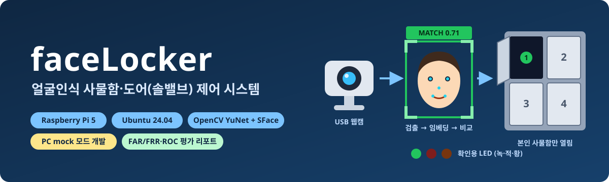
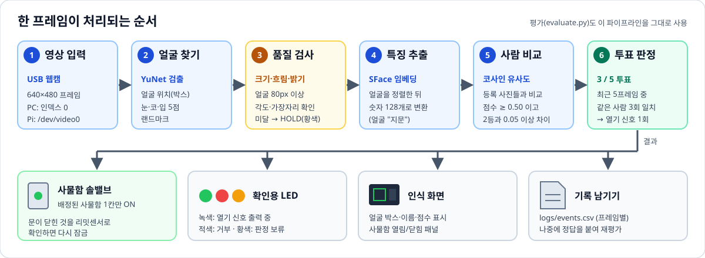
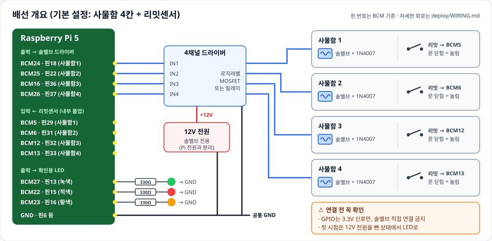

<p align="center">
  
</p>

# facedoor — 얼굴인식 사물함·도어 제어 시스템

라즈베리파이 5와 USB 웹캠으로 **등록된 사람의 얼굴을 알아보고, 그 사람에게 배정된 사물함의 솔밸브만 열어 주는** Python 프로그램입니다.
인식이 얼마나 믿을 만한지 **표와 그래프(FAR·FRR·ROC 등)로 평가하는 도구**도 함께 들어 있습니다.

라즈베리파이가 없어도 됩니다. **PC에서 mock(가상 하드웨어) 모드로 전체 흐름을 먼저 개발·시험**하고, 설정 한 줄(`hardware.mode: pi`)만 바꿔 실제 장치로 옮깁니다.

> **상태:** PC mock 모드에서 개발·테스트를 마쳤습니다. 라즈베리파이 실기 배선과 동작은 아직 검증 전이므로, 처음 연결할 때는 [배선 가이드](deploy/WIRING.md)의 시험 순서를 꼭 따라 주세요.

---

## 목차

1. [주요 기능](#1-주요-기능)
2. [동작 원리](#2-동작-원리)
3. [하드웨어 구성](#3-하드웨어-구성)
4. [빠른 시작 (PC)](#4-빠른-시작-pc)
5. [얼굴 등록과 실행](#5-얼굴-등록과-실행)
6. [인식 신뢰도 평가](#6-인식-신뢰도-평가)
7. [라즈베리파이로 옮기기](#7-라즈베리파이로-옮기기)
8. [폴더 구조](#8-폴더-구조)
9. [안전과 개인정보](#9-안전과-개인정보)
10. [더 읽을 문서](#10-더-읽을-문서)

---

## 1. 주요 기능

| 기능 | 설명 |
|---|---|
| 얼굴 등록 | 웹캠 또는 사진 폴더로 한 사람당 여러 장 등록. 마스크·안경·저조도 같은 **조건별 태그**를 붙여 다양하게 등록 |
| 실시간 인식 | YuNet으로 얼굴을 찾고, SFace로 얼굴을 숫자 128개(임베딩)로 바꾼 뒤 등록된 사람과 비교 |
| 오인식 방지 | 품질 검사(흐림·어두움·작은 얼굴은 보류) + **최근 5프레임 중 3번 일치해야** 열기 |
| 사물함별 출력 | 인식된 사람의 **배정 사물함 1칸만** 솔밸브 ON (기본 4칸) |
| 리밋센서 잠금 | 문이 실제로 닫힌 것을 리밋센서로 확인한 뒤 다시 잠금. 최대 30초가 지나면 무조건 잠금 |
| 확인용 LED | 녹색(열기 신호 중), 적색(거부), 황색(판정 보류) |
| 한글 화면 | 인식 화면(웹캠 + 사물함 열림/닫힘 패널), 관리자 화면(사용자 등록·사물함 배정·삭제, PIN 보호) |
| 평가 리포트 | FAR/FRR/TAR, ROC, DET, EER, 혼동행렬, 점수 분포, **조건별(조명·마스크·안경·목도리) 인식률**을 HTML 리포트로 생성 |
| PC 시뮬레이션 | 하드웨어 없이 PC에서 GPIO·리밋센서 동작을 가상으로 시험 (키보드 1~4로 문 열기/닫기) |

---

## 2. 동작 원리

<p align="center">
  
</p>

웹캠 화면 한 장(프레임)이 들어올 때마다 위 순서로 처리됩니다.

1. **영상 입력:** 웹캠에서 640×480 크기의 화면을 받아옵니다.
2. **얼굴 찾기:** YuNet 모델이 얼굴 위치와 눈·코·입 5점을 찾습니다.
3. **품질 검사:** 얼굴이 너무 작거나, 흐리거나, 어둡거나, 옆을 보고 있으면 판정하지 않고 **보류(HOLD)** 합니다. 나쁜 화면으로 억지로 판정하다가 엉뚱한 사람으로 착각하는 것을 막기 위해서입니다.
4. **특징 추출:** SFace 모델이 얼굴을 숫자 128개로 바꿉니다. 같은 사람의 얼굴은 비슷한 숫자 묶음이 나옵니다. 일종의 "얼굴 지문"입니다.
5. **사람 비교:** 등록된 얼굴들과 **코사인 유사도**(두 숫자 묶음이 얼마나 같은 방향인지, 1에 가까울수록 비슷함)를 계산합니다. 점수가 0.50 이상이고, 2등과 0.05 이상 차이 날 때만 "그 사람"으로 인정합니다.
6. **투표 판정:** 한 번 맞았다고 바로 열지 않습니다. **최근 5프레임 중 같은 사람이 3번** 나와야 열기 신호를 1번 보냅니다.

> **보안 우선 설계:** 임계값(0.50)은 OpenCV 권장값(0.363)보다 일부러 높게 잡았습니다. 등록자가 가끔 한 번 더 서 있어야 하는 불편(FRR)보다, **남에게 문이 열리는 사고(FAR)를 막는 것**을 우선했습니다. 평가 데이터를 충분히 모으면 [평가 도구](#6-인식-신뢰도-평가)로 임계값을 보정할 수 있습니다.

---

## 3. 하드웨어 구성

### 3.1 준비물

| 부품 | 수량 | 비고 |
|---|---|---|
| Raspberry Pi 5 | 1 | Ubuntu 24.04 (64bit). 전원은 USB-C 5V/5A 정품 어댑터 권장 |
| microSD 카드 | 1 | 32GB 이상 |
| USB 웹캠 (UVC) | 1 | MJPG 640×480 지원 제품. 리눅스 드라이버가 필요 없는 일반 USB 웹캠 |
| 4채널 드라이버 | 1 | **로직레벨 N-MOSFET 모듈(권장)** 또는 옵토 절연 릴레이 모듈. 3.3V 신호로 확실히 켜지는 제품 |
| 솔밸브(잠금 솔레노이드) 12V | 4 | **연속 통전 30초 이상** 견디는 제품인지 확인 |
| 플라이백 다이오드 1N4007 | 4 | 솔밸브마다 1개 (역기전력 차단) |
| 리밋 스위치 | 4 | 문이 닫히면 눌리도록 설치. **NC 접점 배선 권장** |
| LED (녹·적·황) + 330Ω 저항 | 각 1 | 상태 표시용 |
| 12V 전원 어댑터 | 1 | 솔밸브 전용, 1A 이상 (0.5A 솔밸브 1개 동시 개방 기준) |

### 3.2 배선 개요

<p align="center">
  
</p>

| 기능 | BCM 번호 | 물리 핀 | 방향 |
|---|---|---|---|
| 사물함 1~4 솔밸브 | 24, 25, 16, 26 | 18, 22, 36, 37 | 출력 → 드라이버 IN1~IN4 |
| 사물함 1~4 리밋센서 | 5, 6, 12, 13 | 29, 31, 32, 33 | 입력 (내부 풀업, 반대쪽은 GND) |
| 녹색 / 적색 / 황색 LED | 27 / 22 / 23 | 13 / 15 / 16 | 출력 (330Ω 직렬) |
| GND | — | 6, 9, 14, 20 등 | 12V 전원 GND와 **공통** 연결 |

핀 번호를 바꾸려면 코드가 아니라 설정 파일 `configs/default.yaml`(또는 장치별 `configs/local.yaml`)의 `hardware` 항목을 고칩니다.

### 3.3 연결할 때 꼭 지켜야 할 점

> [!WARNING]
> - **GPIO는 3.3V 전용입니다.** 5V나 12V가 GPIO 핀에 들어가면 라즈베리파이가 망가집니다.
> - **솔밸브를 GPIO에 직접 연결하지 마세요.** 반드시 MOSFET 또는 릴레이 모듈을 거치고, 솔밸브마다 다이오드(1N4007)를 역방향으로 붙입니다.
> - **전원은 따로, GND는 공통으로.** 솔밸브 12V 전원과 라즈베리파이 전원은 분리하고 GND만 묶습니다.
> - **릴레이 모듈의 극성(active-low)을 확인하세요.** 설정 `active_high`가 실제 모듈과 반대면 **프로그램 시작과 동시에 사물함 4개가 모두 열립니다.**
> - **첫 시험은 12V 전원을 뺀 상태에서** 모듈 LED로 동작 순서를 먼저 확인합니다.

자세한 회로도(MOSFET 방식, 릴레이 방식, 리밋센서 NC 배선), 부팅 시 오동작 대책, 전원 용량 계산은 **[deploy/WIRING.md](deploy/WIRING.md)** 에 있습니다.

---

## 4. 빠른 시작 (PC)

Python **3.12 또는 3.13**이 필요합니다.

```bash
# 1) 내려받기
git clone https://github.com/kgh-DaC/26PJT_facedoor.git
cd 26PJT_facedoor

# 2) 가상환경 만들고 켜기
python -m venv .venv
.venv\Scripts\activate          # Windows
# source .venv/bin/activate     # macOS / Linux

# 3) 필요한 패키지 설치
pip install -r requirements.txt
pip install -e .

# 4) 얼굴 모델 내려받기 (YuNet, SFace — 처음 한 번만, 약 39MB)
python scripts/download_models.py

# 5) 테스트 실행 (카메라·GPIO 없이 동작)
python -m pytest
```

> 얼굴 모델 파일(`.onnx`)은 용량 때문에 저장소에 넣지 않았습니다. 4번 명령이 공식 주소에서 받아 SHA256으로 손상 여부까지 확인합니다.

---

## 5. 얼굴 등록과 실행

### 5.1 관리자 화면 (추천)

```bash
python scripts/admin_gui.py
```

한글 화면에서 **사용자 등록, 사물함 배정, 추가 촬영, 사용자 삭제**를 할 수 있습니다. 처음 실행하면 관리자 PIN을 설정합니다.

### 5.2 명령어로 등록

한 사람을 **여러 조건으로** 등록할수록 마스크·안경·조명 변화에 강해집니다.

```bash
python scripts/enroll.py --name alice --tag normal --display-name 앨리스   # 웹캠으로 정면/좌/우/위/아래 촬영
python scripts/enroll.py --name alice --tag mask                            # 마스크 쓴 얼굴
python scripts/enroll.py --name alice --tag glasses --images D:/photos/alice_glasses   # 사진 폴더로 등록
```

사용할 수 있는 태그: `normal`, `mask`, `glasses`, `noglasses`, `scarf`, `hat`, `lowlight`, `backlight`, `other`

### 5.3 인식 실행

```bash
python scripts/run.py                    # 웹캠 0번 + 가상 GPIO + 인식 화면
python scripts/run.py --no-display       # 화면 없이 실행 (서비스용)
```

- **인식 화면:** 왼쪽은 웹캠(얼굴 박스와 이름·점수), 오른쪽은 사물함 4칸의 열림/닫힘 상태가 보입니다.
- **PC 시뮬레이션:** 키 `1`~`4`는 사물함 문 열기/닫기, `5`~`8`은 리밋센서 고장 흉내, `q`는 종료입니다.
- **기록:** 모든 판정은 `logs/events.csv`에 남아서 나중에 평가에 다시 쓸 수 있습니다.

하드웨어만 따로 시험하려면 아래 명령을 씁니다.

```bash
python scripts/hw_selftest.py                  # LED 순서 점등 (PC에서는 가상)
python scripts/hw_selftest.py --sim-limits     # 문 열기/닫기 시뮬레이션
```

---

## 6. 인식 신뢰도 평가

"우리 시스템이 정말 믿을 만한가?"를 숫자와 그래프로 확인합니다.

```bash
python scripts/evaluate.py --gallery data/gallery --probe data/probe --out reports/
```

`reports/<날짜-시간>/report.html`에 아래 내용이 담긴 리포트가 만들어집니다.

| 지표 | 뜻 |
|---|---|
| **FAR** (타인 수락률) | 등록 안 된 사람(또는 다른 사람)에게 **잘못 열린** 비율. 낮을수록 안전 |
| **FRR** (본인 거부률) | 등록된 본인인데 **안 열린** 비율. 낮을수록 편리 |
| **ROC / DET 곡선** | 임계값을 바꿨을 때 FAR과 FRR이 어떻게 맞바뀌는지 보여주는 그래프 |
| **EER** | FAR과 FRR이 같아지는 지점. 작을수록 좋은 모델 |
| **조건별 인식률** | 정상·마스크·안경·목도리·저조도 등 조건마다 따로 계산한 결과 |
| **혼동행렬·점수 분포** | 누구를 누구로 착각했는지, 본인/타인 점수가 얼마나 잘 갈리는지 |

- **임계값 보정:** `--write-calibration`을 붙이면 목표 FAR(기본 0.1%)에 맞춘 임계값을 `models/calibration.json`에 저장합니다. 데이터가 적으면 **임계값을 올리는 쪽으로만** 반영되어 문이 쉽게 열리는 일이 없습니다.
- **합성 시험 이미지:** `scripts/make_synthetic_probes.py`로 저조도·마스크·안경 등을 흉내 낸 시험 이미지를 만들 수 있습니다. 실제 촬영을 대신하지는 못하므로 리포트에 "참고용"으로 따로 표시됩니다.

---

## 7. 라즈베리파이로 옮기기

```bash
# 라즈베리파이 5 (Ubuntu 24.04)에서
git clone https://github.com/kgh-DaC/26PJT_facedoor.git
cd 26PJT_facedoor
sudo deploy/install_rpi.sh               # 한 번에 설치 (아래 설명 참고)

# 솔밸브 12V 전원을 뺀 상태에서 하드웨어 점검
.venv/bin/python scripts/hw_selftest.py --mode pi --limits      # 리밋센서: 문을 여닫으며 해당 번호만 바뀌는지
.venv/bin/python scripts/hw_selftest.py --mode pi --allow-solenoid --all-lockers --pulse-sec 0.5   # 채널이 1→4 순서로 켜지는지
```

설치 스크립트가 해 주는 일:

- **패키지:** 필요한 apt 패키지와 가상환경(`.venv`)을 설치합니다.
- **모델:** 얼굴 모델을 내려받습니다.
- **GPIO 권한:** 현재 사용자에게 GPIO·카메라 권한을 줍니다.
- **실기 설정:** `configs/local.yaml`에 `hardware: {mode: pi}`를 만들어 실제 GPIO를 쓰게 합니다.
- **자동 실행:** systemd 서비스를 등록합니다. 바로 시작하지는 않으며, 시작하려면 `--start` 옵션을 붙입니다.

- **OpenCV:** Ubuntu의 `apt install python3-opencv`(4.6)는 **쓰면 안 됩니다.** YuNet에 4.8 이상이 필요하므로 설치 스크립트가 pip 버전을 설치합니다.
- **GPIO 라이브러리:** 라즈베리파이 5는 `RPi.GPIO`가 동작하지 않아 `gpiozero` + `lgpio`를 사용합니다.
- **자동 실행:** `deploy/facedoor.service`(systemd)로 부팅 시 자동 실행됩니다. 프로그램이 어떤 이유로 꺼져도 솔밸브 출력을 강제로 OFF합니다.
- **SD카드 미리 만들기:** PC에서 SD카드를 준비해 첫 부팅 때 자동 설치하는 도구가 `deploy/sdcard/`에 있습니다.

단계별 체크리스트는 **[docs/PORTING.md](docs/PORTING.md)** 를 보세요.

---

## 8. 폴더 구조

```
26PJT_facedoor/
├── src/facedoor/         # 본체 코드
│   ├── camera.py         #   웹캠/동영상/이미지 폴더 입력
│   ├── detector.py       #   얼굴 검출 (YuNet)
│   ├── quality.py        #   품질 검사 (HOLD 판정)
│   ├── embedder.py       #   얼굴 → 숫자 128개 (SFace / ArcFace)
│   ├── recognizer.py     #   등록자와 비교, 임계값 적용
│   ├── decision.py       #   5프레임 중 3회 투표
│   ├── app.py            #   전체 실행 루프
│   ├── hardware/         #   GPIO 제어 (pi: 실제 / mock: 가상)
│   ├── gui/              #   관리자 화면
│   └── evaluation/       #   FAR/FRR/ROC 평가, 리포트 생성
├── scripts/              # 실행 명령 (run, enroll, evaluate, admin_gui, hw_selftest …)
├── configs/default.yaml  # 모든 설정 (핀 번호, 임계값, 시간 등)
├── deploy/               # 라즈베리파이 설치·서비스·배선 문서·SD카드 도구
├── docs/                 # 설계 문서
├── models/               # 모델 목록·체크섬 (.onnx 파일은 내려받아 사용)
└── tests/                # 자동 테스트 (pytest)
```

---

## 9. 안전과 개인정보

**안전 (fail-safe):**

- **종료 시 OFF:** 프로그램 종료, 오류, 강제 종료(Ctrl+C, systemd stop) 때 모든 솔밸브 출력을 OFF합니다.
- **최대 해제 시간:** 솔밸브는 해제 후 **최대 30초**(코드 상한 120초)가 지나면 센서 상태와 관계없이 잠깁니다.
- **센서 이상:** 리밋센서를 읽지 못하면 즉시 잠그고 새 해제 요청을 거부합니다.
- **출력 불일치:** 열려서는 안 되는 채널이 켜진 것이 감지되면 **전 채널 OFF 후 정지**합니다.

**개인정보:**

- **저장소 제외:** 얼굴 사진·임베딩(`data/`), 출입 로그(`logs/`), 평가 리포트(`reports/`)는 `.gitignore`로 막혀 있어 **GitHub에 올라가지 않습니다.**
- **테스트 이미지:** `tests/assets/`의 이미지는 OpenCV 등에서 널리 쓰는 공개 샘플이며, 학생·교직원 사진이 아닙니다.
- **동의:** 얼굴을 등록하기 전에 당사자의 동의를 받아 주세요.

---

## 10. 더 읽을 문서

| 문서 | 내용 |
|---|---|
| [docs/ARCHITECTURE.md](docs/ARCHITECTURE.md) | 전체 구조와 설계 이유 (임계값 정책, 마스크 대응, 상태 머신) |
| [docs/INTERFACES.md](docs/INTERFACES.md) | 모듈 간 약속(함수·설정·로그 형식)의 정본 |
| [docs/RUN_AND_ENROLL.md](docs/RUN_AND_ENROLL.md) | 등록·실행 명령 상세 옵션 |
| [deploy/WIRING.md](deploy/WIRING.md) | 회로도, 극성, 전원 용량, 시험 순서 |
| [docs/SCENARIO_WIRING_PINS.md](docs/SCENARIO_WIRING_PINS.md) | 시나리오별 핀 배치 |
| [docs/PORTING.md](docs/PORTING.md) | PC → 라즈베리파이 이식 체크리스트 |

---

## 사용한 모델과 라이선스

| 모델 | 용도 | 라이선스 |
|---|---|---|
| [YuNet](https://github.com/opencv/opencv_zoo/tree/main/models/face_detection_yunet) (`face_detection_yunet_2023mar.onnx`) | 얼굴 검출 | MIT |
| [SFace](https://github.com/opencv/opencv_zoo/tree/main/models/face_recognition_sface) (`face_recognition_sface_2021dec.onnx`) | 얼굴 임베딩 (기본) | Apache-2.0 |
| ArcFace w600k_r50 (선택) | 고정밀 임베딩 | InsightFace 비상업 라이선스, 사용자가 직접 배치 |

이 프로젝트 코드의 라이선스는 아직 정하지 않았습니다.
